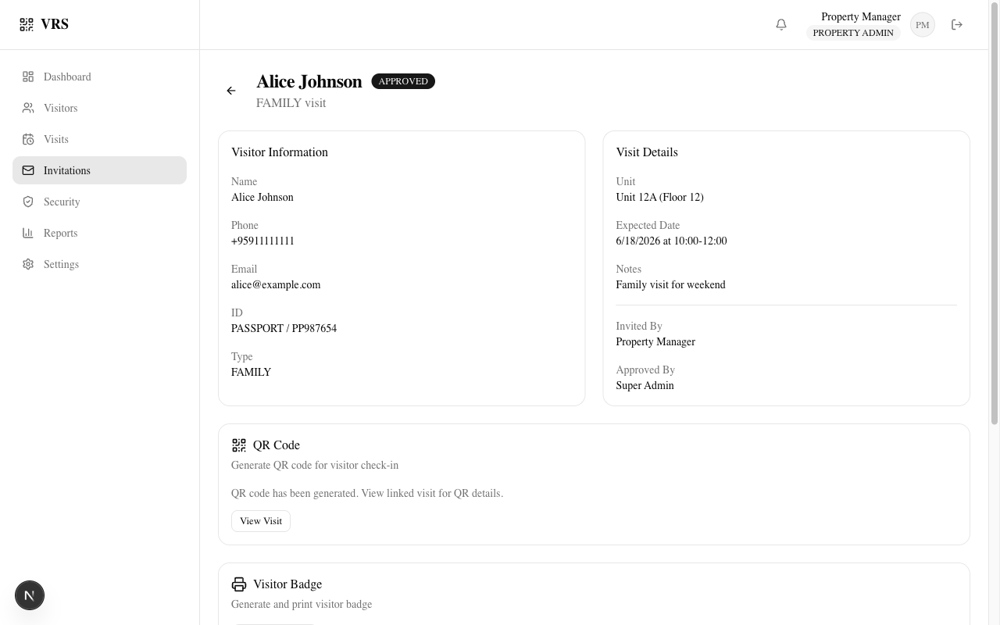

<style>
section.compact {
  font-size: 28px;
}

section.compact h2 {
  margin-bottom: 0.35em;
}

section.compact table {
  font-size: 0.86em;
}

section.compact p,
section.compact ul {
  margin-top: 0.25em;
  margin-bottom: 0.25em;
}
</style>

<!-- _class: lead -->
<!-- 20s -->

# 🏢 Visitor Registration System

## QR-Based Digital Visitor Management

### Secure · Fast · Auditable


> 🎤 _"Hi, I'm Aung. I built a visitor registration system that replaces paper visitor logs with digital QR codes. Here's the story."_

---

<!-- 20s -->

<!-- _class: compact -->

## 🔍 The Problem

- Paper visitor logs are **slow, insecure, unsearchable**
- No real-time arrival notification for hosts
- No audit trail for security incidents
- The same problem shows up in condos, offices, and warehouses

> 🎤 _"A clipboard at the front desk creates delays, weak security, and no useful record. Hosts do not know when visitors arrive, and incidents leave no audit trail."_

---

<!-- 20s -->

<!-- _class: compact -->

## 🎯 The Solution

| Feature            | Description                         |
| :----------------- | :---------------------------------- |
| 🔲 QR Check-In/Out | SHA-256 hashed, time-limited tokens |
| 🛡️ 5-Role RBAC     | Property-level data isolation       |
| 🔔 Notifications   | Real-time host alerts               |
| 📊 Audit Logging   | 25+ event types with metadata       |

> 🎤 _"Our system replaces the clipboard with a web app. Security scans the QR at the gate, the system verifies identity, records check-in, and notifies the host in seconds."_

---

<!-- 20s -->

<!-- _class: compact -->

## 🧠 Claude Code AI Workflow

| Phase           | Tool                      |
| :-------------- | :------------------------ |
| Requirements    | Product Manager Agent     |
| Architecture    | Software Architect Agent  |
| Database Design | Prisma Reviewer Subagent  |
| API Design      | API Reviewer Subagent     |
| Implementation  | Backend + Frontend Agents |
| Testing         | Software Tester Subagent  |
| DevOps          | DevOps Engineer Subagent  |
| Release         | Release Manager Subagent  |

> 🎤 _"I used dedicated AI agents for every phase. The Product Manager defined requirements, the Architect reviewed design, and the Prisma Reviewer validated the schema."_

---

<!-- 20s -->

## 🔧 MCP Infrastructure

**5 MCP Servers configured:**

- **Context7** — Real-time library documentation
- **Playwright** — Browser automation & E2E
- **Sequential Thinking** — Complex problem solving
- **GitHub** — Repository management
- **PostgreSQL** — Direct database introspection

> 🎤 _"MCP — the Model Context Protocol — gives Claude real tools. Context7 pulls live docs so we never use outdated APIs. Playwright controls a real browser for testing. PostgreSQL connects directly to inspect the database. These aren't mock tools — they're real infrastructure."_

---

<!-- 20s -->

## 🤖 Skills & Agents

**18 Skills** in `.claude/skills/`:

- `database-design`, `qr-workflow`, `testing`
- `security-review`, `docker-production`, `github-actions`
- `prisma-best-practice`, `ui-dashboard`, `speckit-*` suite

**5 Agents** in `.claude/agents/`:

- Product Manager, Software Architect
- Backend Developer, Frontend Developer
- UI/UX Designer

> 🎤 _"Skills encode our project rules — database design standards, QR security requirements, testing strategy. Every time we work on the codebase, these skills are loaded as context. The agents are specialized roles with defined responsibilities."_

---

<!-- 20s -->

## 🔄 Multi-Agent Workflows

**5 Workflows** in `.claude/workflows/`:

```text
audit-project.js         — Code quality audit
generate-release-notes.js — Automated changelogs
review-code.js           — Multi-agent code review
run-tests.js             — Parallel test execution
verify-phase.js          — Phase completion check
```

> 🎤 _"Workflows orchestrate multiple agents in parallel. The audit workflow spawns independent reviewers for security, database, and architecture — then synthesizes their findings. Review-code spawns skeptics that try to refute each other's findings. This is where multi-agent really shines."_

---

<!-- 20s -->

## 💻 Tech Stack

| Layer    | Technology                       |
| :------- | :------------------------------- |
| Frontend | Next.js 16, React 19, TypeScript |
| Styling  | Tailwind CSS 4, shadcn/ui        |
| Backend  | Next.js Route Handlers           |
| Database | PostgreSQL 16, Prisma 7          |
| Auth     | JWT (jose), bcryptjs             |
| Testing  | Vitest (264) + Playwright (50)   |
| DevOps   | Docker Compose, GitHub Actions   |

> 🎤 _"Modern stack throughout. Next.js 16 for both frontend and backend. Prisma 7 for type-safe database access. JWT with refresh token rotation. And 314 automated tests guard every change."_

---

<!-- 20s -->

## 🏗️ System Architecture

```text
Browser → Next.js App
            ├── Authentication (JWT + RBAC)
            ├── Visitor Module
            ├── Visit Module
            ├── Invitation + Approval
            ├── QR Service (SHA-256 hashing)
            ├── Badge Service
            ├── Notification Service
            └── 14 Models / 16 Enums
```

> 🎤 _"It's a modular monolith — Next.js handles routing, middleware injects user context from JWT, route handlers enforce RBAC, and Prisma provides type-safe database access. Clean separation without microservice complexity."_

---

<!-- 20s -->

## 🔐 Security Architecture

| Feature       | Detail                            |
| :------------ | :-------------------------------- |
| JWT Auth      | Refresh token rotation            |
| RBAC          | 5 roles, property-level isolation |
| Rate Limiting | Auth endpoint protection          |
| Audit Logs    | 20+ event types                   |
| QR Protection | Single-use, SHA-256 hashed        |

> 🎤 _"Security was designed in from day one. JWT with separate access and refresh tokens. Five roles with property-level scoping — a RESIDENT in Property A cannot see data from Property B. Rate limiting on auth endpoints. Every action is audited. QR tokens are single-use and cryptographically hashed."_

---

<!-- 20s -->

## 🚗 Vehicle Management (v1.4.0)

| Feature       | Description                   |
| :------------ | :---------------------------- |
| Vehicle CRUD  | Register, search, soft-delete |
| Owner Linking | Residents & visitors          |
| Blacklist     | Auto-reject blocked plates    |
| QR Scanner    | Camera-based gate workflow    |

> 🎤 _"Phase 4 added vehicle management. Residents register their vehicles. Security can search by plate number. Blacklisted plates are auto-rejected at check-in. The camera-based QR scanner enables real-time gate verification."_

---

<!-- 20s -->

## 🔳 QR Workflow

```text
Invitation → Approval → QR Generate → Email QR → Security Scan → Check-In → Audit
```

- 🔐 **SHA-256 hashed** — cryptographically random tokens
- ⏱️ **Single-use with expiry** — replay protection built-in
- 📧 **Email delivery** — QR sent directly to visitor
- 🔔 **Real-time host notification** on check-in

> 🎤 _"The QR workflow is the heart of the system. A resident pre-registers a visitor. An admin approves. A QR code is generated — cryptographically random, SHA-256 hashed, single-use with expiry. The visitor arrives, security scans the QR, verifies identity, and checks them in. The host gets notified instantly."_

---

<!-- 20s -->

## 🔔 Notification Module (v1.2.0)


- 📬 **7 Event Types** across full lifecycle
- 🔔 **Bell Icon** with real-time unread badge
- 📋 **Dropdown List** with relative timestamps
- ✅ **Mark Read / Mark All Read** with server verification
- 🧩 **4-File Library** — templates, builder, recipients, service

> 🎤 _"v1.2.0 shipped the notification module. Seven event types fire across the full invitation and visit lifecycle. The bell icon polls every 30 seconds. Mark-all-read re-fetches from the server — no optimistic UI guess. The library is four pure files with a clear separation of concerns."_

---

<!-- 20s -->

## 📊 Database Design

**14 Models · 16 Enums · Full Index Coverage**

```text
Property → Unit → User
Visitor → Visit → QRCode
Invitation → Approval → Badge
Verification → AuditLog → Blocklist
Notification (v1.2.0)
```

**Multi-tenancy:** Every table scoped by `property_id`

> 🎤 _"Fourteen models, sixteen enums, with composite indexes on every common query pattern. The key design principle is multi-tenancy — every table has property_id."_

---

<!-- 20s -->

## 🐳 Docker Architecture

```yaml
services:
  postgres: # PostgreSQL 16 Alpine
    - Healthcheck: pg_isready
    - Named volume: vrs_postgres_data
  app: # Next.js (standalone output)
    - Multi-stage build
    - Non-root user (nextjs:nodejs)
    - Depends on postgres (healthy)
```

`docker compose up --build -d` → Production ready

> 🎤 _"Docker Compose with two services. PostgreSQL with healthchecks and persistent storage. The app uses a multi-stage build — compiles in the builder stage, runs as a non-root user in a minimal Alpine runner. One command to deploy."_

---

<!-- 20s -->

## 🧪 Testing Strategy

| Suite               | Count    | Status      |
| :------------------ | -------- | :---------- |
| Unit (Vitest)       | **264**  | ✅ All Pass |
| E2E (Playwright)    | **50**   | ✅ All Pass |
| TypeScript + ESLint | 0 errors | ✅ Clean    |

> 🎤 _"264 unit tests cover validations, JWT, RBAC, API responses. 50 Playwright E2E tests cover the full workflow — smoke, invitation, notification, RBAC. All 314 tests pass before any code merges."_

---

<!-- 20s -->

## 📦 Git Releases

| Version | Key Feature                     |
| :------ | :------------------------------ |
| v1.0.0  | Core MVP                        |
| v1.1.0  | Invitation & Approval Workflow  |
| v1.2.0  | Notification Module             |
| v1.4.0  | Vehicle Management & QR Scanner |

**Semantic versioning** · GitHub Releases · Docker ready

> 🎤 _"Four releases with full GitHub Release notes. Semantic versioning. Every release is tagged, documented, and reproducible via Docker."_

---

<!-- 20s -->

## 📸 UI Screenshots



**Invitation Detail Page:**

- Visitor information card
- Visit details with unit, date, host
- QR code generation section
- Badge printing
- Approval history
- Status timeline

> 🎤 _"Here's the invitation detail page. You can see the approved invitation with visitor information, the QR code section for generation, the badge printer, the approval history showing who approved it, and a status timeline at the bottom."_

---

<!-- 20s -->

## 🗺️ Roadmap

| Phase | Feature                          | Status      |
| :---- | :------------------------------- | :---------- |
| 1-6   | Core + Invitation + Notification | ✅ Complete |
| 6.5   | QR Email Delivery                | ✅ Complete |
| 7     | Vehicle Management & QR Scanner  | ✅ Complete |
| 8     | Self-Kiosk, Mobile QR Scanner    | 🔜 Upcoming |
| 9     | AI Analytics, Suspicious Alerts  | 🔜 Upcoming |

> 🎤 _"Phase 7 vehicle management and QR camera scanner are complete. Phase 8 brings self-service kiosks and mobile QR scanning. Phase 9 introduces AI analytics — suspicious visitor detection, peak hour prediction, and natural language reporting."_

---

<!-- _class: lead -->
<!-- 20s -->

## 🙏 Thank You

**Visitor Registration System v1.4.0**

🔗 [github.com/aungyephyo2215/vct-visitor-registration-system](https://github.com/aungyephyo2215/vct-visitor-registration-system)

📊 **314 Tests** | 🐳 **Docker Ready** | 🔐 **5-Role RBAC**

> 🎤 _"Thank you. The repository is public with full documentation, screenshots, release notes, and a one-command Docker deployment. I'm happy to take questions."_
