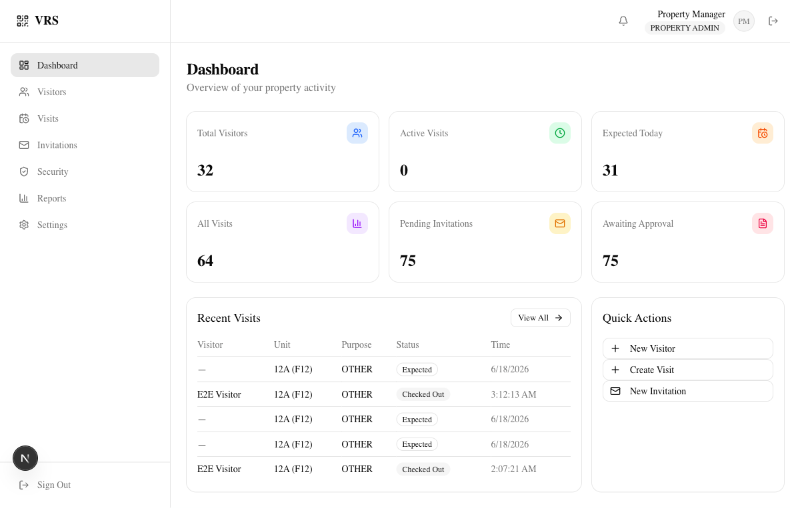
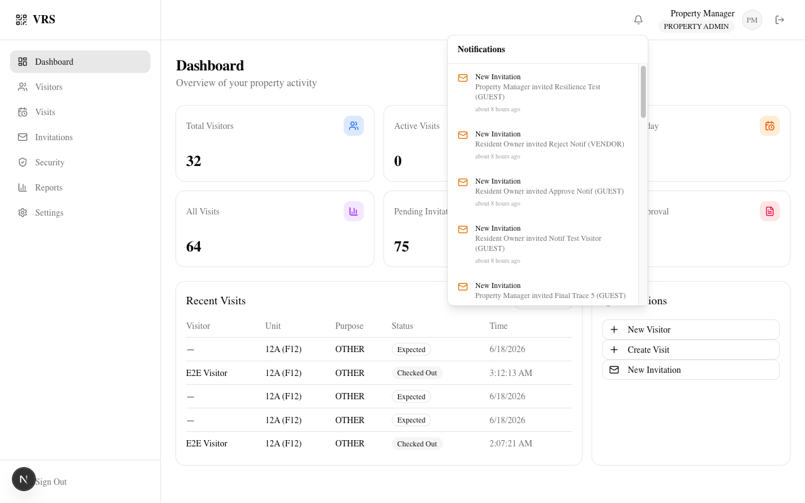

<!-- _class: lead -->
<!-- 20s -->

# 🏢 Visitor Registration System

## QR-Based Digital Visitor Management

### Secure · Fast · Auditable

> 🎤 _"Hi, I'm Aung. I built a visitor registration system that replaces paper logs with QR codes. Here's the story."_

---

<!-- 20s -->

## 🔍 Problem → 🎯 Solution

**Problem:** Paper logs. No audit trail. No host notifications. Slow security checks. Four property types share the same challenge.

**Solution:** Web-based VRS — QR check-in/out with cryptographic tokens, 5-role RBAC, real-time notification bell, blocklist validation, and complete audit logging.



> 🎤 _"Every condo, office, and warehouse uses clipboards at the front desk. Our system replaces that with a QR code scan — instant blocklist check, identity verification, host notification, all in seconds."_

---

<!-- 20s -->

## 📐 Development Methodology

**Spec-Driven — "Never Code First"**

```text
Requirements → Architecture → Database → API → UI
                                                  ↓
                                            Code + Test
                                                  ↓
                                     Docker + CI/CD + Deploy
```

> 🎤 _"Every feature starts with a written spec. Architecture is reviewed before code. Database schema is designed first. API contracts are defined. Then UI, implementation, testing, and deployment. This catches expensive mistakes early."_

---

<!-- 20s -->

## 🏗️ Architecture & Security

```text
Browser → Next.js 16 → JWT + 5-Role RBAC
                    → Visitor / Visit / Invitation / QR Modules
                    → Notification Bell + 7 Event Types
                    → Prisma 7 → PostgreSQL 16
```

**14 Models · 16 Enums · Full Indexes · Multi-Tenancy**

**Notification Module:** 4-file library · Fire-and-forget · Server-truth re-fetch

**Security:** JWT with refresh tokens · Rate limiting · QR replay protection · 20+ audit event types · Property-level data isolation



> 🎤 _"Next.js modular monolith. Five roles scoped by property_id. The notification module is a 4-file library with fire-and-forget design — failures never block parent operations. QR tokens are cryptographically random, SHA-256 hashed, single-use with expiry."_

---

<!-- 20s -->

## 🧪 Quality Gates & Releases

```text
npm ci → lint → type check → 264 unit tests → build → 50 E2E tests
```

| Suite               | Tests    | Result     |
| :------------------ | -------- | :--------- |
| Unit (Vitest)       | 264      | ✅ Passing |
| E2E (Playwright)    | 50       | ✅ Passing |
| TypeScript + ESLint | 0 errors | ✅ Clean   |
| npm audit           | 0 vulns  | ✅ Clean   |

**v1.0.0 → v1.1.0 → v1.2.0 → v1.4.0** · Semantic versioning · Docker ready

> 🎤 _"Every commit passes CI: lint, type check, 264 unit tests, build. 50 Playwright E2E tests cover the full workflow — smoke, invitation, notification, RBAC. Three releases in three days with full GitHub Release notes. One command to deploy: docker compose up."_

---

<!-- _class: lead -->
<!-- 20s -->

## 🙏 Thank You

**Visitor Registration System v1.2.0**

🔗 [github.com/aungyephyo2215/vct-visitor-registration-system](https://github.com/aungyephyo2215/vct-visitor-registration-system)

📊 **314 Tests** · 🐳 **Docker Ready** · 🔐 **5-Role RBAC**

> 🎤 _"The repo is public with full documentation, screenshots, and a one-command Docker deployment. I'm happy to take questions. Thank you."_
